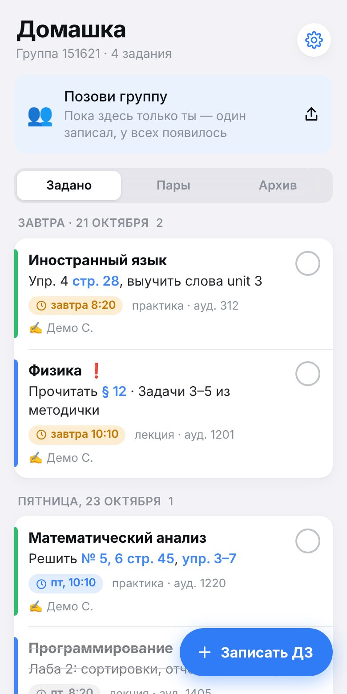
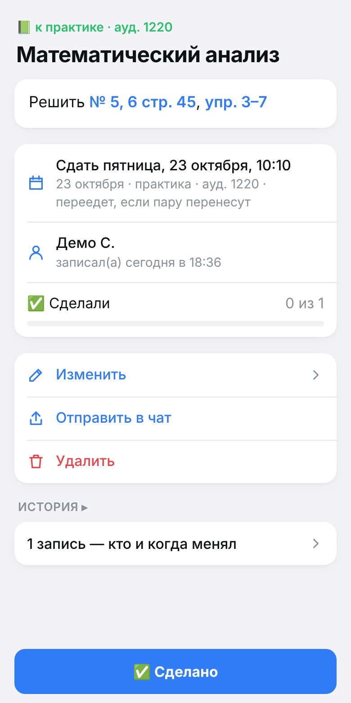
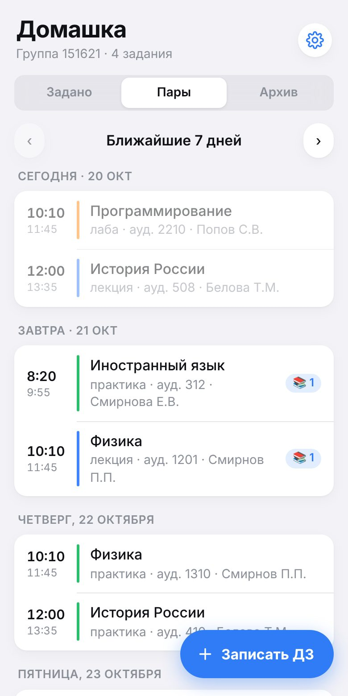

# Арктика · ДЗ — бот домашки для всего САФУ

Telegram-бот и мини-приложение: **один записал ДЗ — у всей группы появилось.** Все группы и преподаватели вуза берутся из [РУЗ САФУ](https://ruz.narfu.ru), сроки сами встают к следующей паре и переезжают, если пару перенесут. Всё записанное хранится: удалённое лежит в корзине, у каждого задания есть история правок, прошлые ДЗ — в архиве за весь семестр.

| Задано | Задание | Пары |
|---|---|---|
|  |  |  |

## Что умеет

**Студенты**
- Регистрация за 10 секунд: номер группы → готово. Можно по ссылке-приглашению `t.me/<бот>?start=g151621` — сразу в нужную группу.
- Записать ДЗ — просто написать боту «*Матан: № 5, 6 стр 45*» или прислать фото доски с подписью. Бот поймёт предмет («матан», «физра», «англ» — тоже), предложит срок: к следующей паре, к следующей практике, через одну, завтра, через неделю или свою дату.
- Задание тут же приходит всем из группы в личку с кнопкой «✅ Сделано», а в чат группы — постом. Правки обновляют уже разосланные сообщения, а не шлют новые.
- Отметка «сделано» — своя у каждого. `/dz` — всё, что задано, `/zavtra` — на завтра, `/archive` — что задавали раньше.
- Вечером (по умолчанию в 20:00, время своё) — что сдавать завтра, если ещё не сделано.
- РУЗ перенёс пару — срок ДЗ едет следом, группе приходит «⏰ Срок сдвинулся».

**Чаты групп**
- Добавить бота в чат и написать `/group 151621` (админ чата). Новые ДЗ — в чат, в 20:00 — сводка на завтра.
- Записать прямо из чата: `/add Матан: № 5, 6` или ответом на сообщение/фото с заданием — `/add Матан`.
- Кто привязал чат — староста группы: может править и удалять любые ДЗ группы и возвращать их из корзины. Других старост админ назначает ответом `/starosta`.

**Преподаватели**
- «Я преподаватель» → фамилия из РУЗ (или ссылка на своё расписание). Бот находит все пары по всему вузу.
- Задать ДЗ — выбрать пару: задание появится у всех студентов всех групп потока, с отметкой «👩‍🏫 от преподавателя».
- Видно, сколько студентов уже сделали. Задания преподавателя студенты и старосты править не могут.
- Отметка «от преподавателя» — после подтверждения администратором (кнопка приходит ему в бот).

**Мини-приложение** (кнопка «ДЗ» у поля ввода в боте) — то же самое, но удобнее: список по дням, задание с фото и историей, редактор со сроками, пары недели с числом ДЗ к каждой, настройки. Выглядит как Telegram — в светлой, тёмной и любой своей теме.

## Запуск

> **Подробная инструкция для первого раза, со всеми кнопками и командами — [ЗАПУСК.md](ЗАПУСК.md).** Ниже — коротко.

Нужен сервер, который работает всегда (бот должен отвечать круглосуточно), и домен — мини-приложения Telegram открываются только по https. Подойдёт самый простой VPS (1 ядро, 1 ГБ) с Docker. Сервер лучше российский: РУЗ может не открываться из-за рубежа.

1. **Бот.** В [@BotFather](https://t.me/BotFather): `/newbot` → имя и username → получить **токен**. Там же: `/setjoingroups` → Enable (чтобы бота можно было добавить в чат группы). Режим приватности (`/setprivacy`) оставить включённым — бот читает в чатах только команды.
2. **Домен.** A-запись, например `dz.example.ru`, — на IP сервера.
3. **Настройки.** На сервере:
   ```bash
   git clone https://github.com/skyface29/safu && cd safu/telegram
   cp .env.example .env   # вписать BOT_TOKEN, DOMAIN и свой ADMIN_IDS (узнать id — @userinfobot)
   docker compose up -d
   ```
   Caddy сам получит сертификат, бот сам поставит вебхук, кнопку «ДЗ» и меню команд. Через минуту можно писать боту `/start`.
4. **Ссылка на мини-приложение из чатов (по желанию).** В BotFather: `/newapp` → выбрать бота → URL `https://dz.example.ru` → короткое имя, например `dz`. Вписать `APP_NAME=dz` в `.env` и `docker compose up -d`.

Проверка: `https://dz.example.ru/health` — сколько людей, групп и ДЗ. Админу в боте — `/stats`.

**Данные** лежат в `telegram/data/arktika-bot.sqlite`, копия базы делается сама раз в сутки в `data/backups` (последние 14 дней). Перенести бота на другой сервер — скопировать папку `data`.

### Без сервера — попробовать у себя

```bash
cd telegram
npm install
npm run demo        # http://localhost:8080 — мини-приложение с выдуманным расписанием, без Telegram и РУЗ
npm test            # тесты: разбор РУЗ, сроки, весь путь «записал → группа получила», API
```

`npm run dev` — разработка с настоящим ботом: `.env` с `BOT_TOKEN` (бот работает через long polling, без домена), мини-приложение — на `http://localhost:5174` (`DEV_USER=1` в `.env` — открывать без Telegram).

## Как устроено

- `server/` — один процесс на Node 22: бот ([grammY](https://grammy.dev)), API мини-приложения ([Hono](https://hono.dev)), раздача мини-приложения, фоновые задачи.
  - `ruz/` — разбор РУЗ (тот же, что в Арктике для Windows и iPhone), справочник школ и групп всего вуза, расписания групп и преподавателей с кешем. Запросы к РУЗ — по одному, с паузой.
  - `schedule.ts` — сроки «к следующей паре / практике / через одну», прогноз по ритму прошлых недель, если пары ещё нет в РУЗ.
  - `homework.ts` — ДЗ группы, права (автор, староста, преподаватель), отметки «сделано», журнал правок, корзина.
  - `hub.ts` — рассылка группе и в чаты (с учётом лимитов Telegram), обновление разосланных карточек, переносы пар, вечерние сводки.
  - `bot/` — диалоги бота, `api.ts` — API мини-приложения; вход по подписи Telegram (`initData`), без паролей.
- `webapp/` — мини-приложение (React), `shared/` — общий код: даты, оформление ДЗ, типы.
- Хранилище — один файл SQLite (встроенный `node:sqlite`).

Фоновые задачи: каждые 5 минут — вечерние сводки; каждые 20 минут — свежие расписания групп, где кто-то есть (не чаще раза в 4 часа на группу); раз в неделю — список групп всего вуза; ночью — обход страниц групп, чтобы знать всех преподавателей.

## Конфиденциальность

У бота, в отличие от приложения, есть сервер — без него группа не увидит общие ДЗ. На нём хранятся только: Telegram id, имя и @username (чтобы подписывать, кто записал), группа или ФИО преподавателя из РУЗ, настройки уведомлений, записанные ДЗ и отметки «сделано». Фото к заданиям хранит сам Telegram. Пароли, почта и личный кабинет вуза боту не нужны. Удалить себя — `/forget` в боте, что хранится — `/privacy`. Подробнее — в [PRIVACY.md](../PRIVACY.md#telegram-бот-домашки).

## Лицензия

© 2026 Зарубин Кирилл. Все права защищены — условия те же, что у всего репозитория: [LICENSE](../LICENSE).
