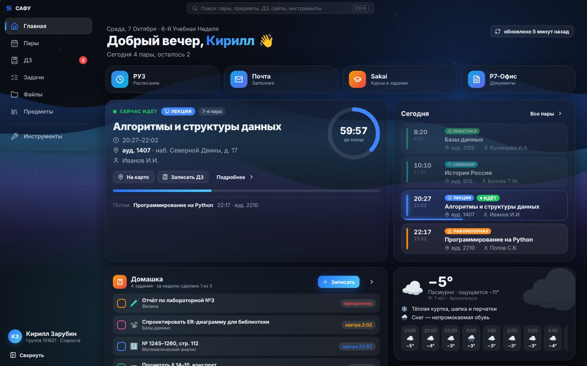
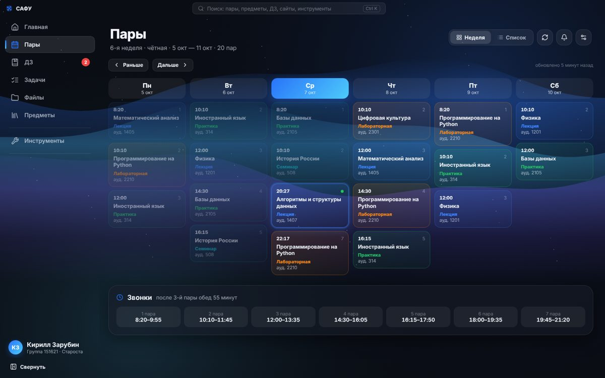
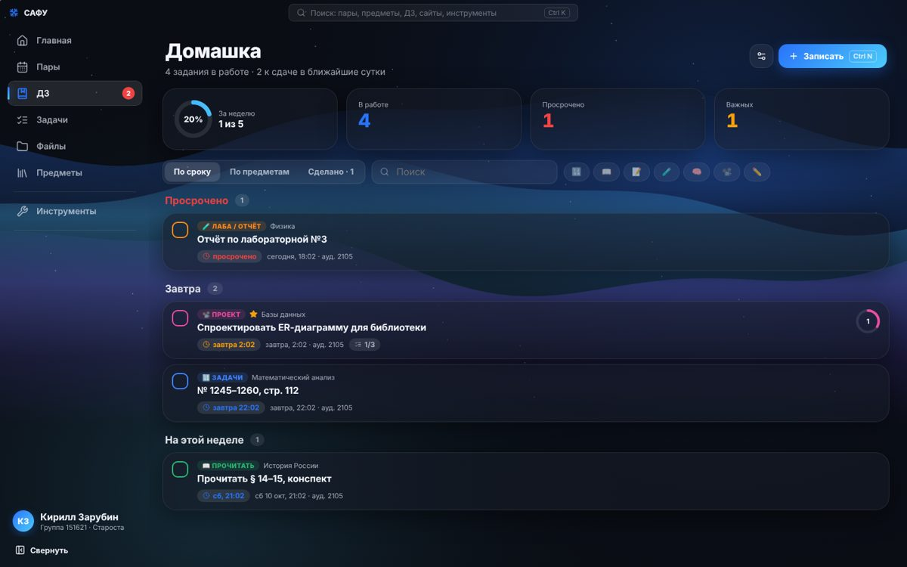
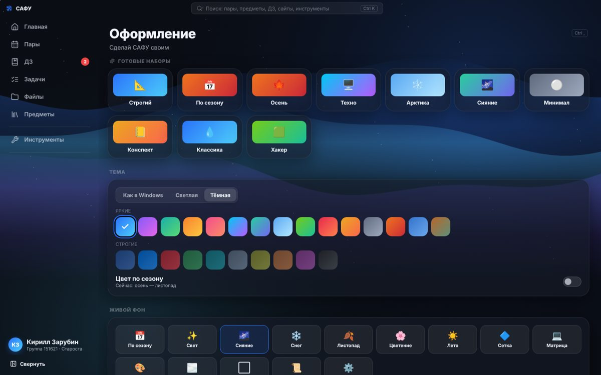
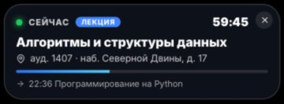

# Арктика для Windows и Linux

Всё то же, что в приложении для iPhone, — только на компьютере: пары из РУЗ, домашка с умными сроками, файлы предметов, БРС, сессия, лекции с конспектами, сайты вуза и почта. Интерфейс с живыми фонами, стеклом и анимациями на каждом шаге.



| Пары неделей | Домашка | Оформление |
|---|---|---|
|  |  |  |

Мини-окно текущей пары поверх всех окон (как Live Activity на iPhone):



## Что есть

- **Пары**: расписание группы из РУЗ, неделя колонками и списком, архив прошлых недель, журнал замен и уведомления о них, звонки, ручной ввод, корпуса, экспорт в Outlook/Календарь (.ics), «отправить расписание дня».
- **Главная**: текущая пара с кольцом-таймером, лента дня, ДЗ, погода и «что надеть», дорога на автобусе, отсчёт до сессии, сайты одной кнопкой. Блоки настраиваются перетаскиванием.
- **Домашка**: срок «к следующей паре / такой же паре / через одну» сам переезжает, если РУЗ перенёс пару; прогноз по прошлым неделям; подпункты, фото, напоминания, «Что задали?» после пары.
- **Файлы**: папки предметов в «Документы\Арктика» (у тех, кто ставил раньше, — в «Документы\САФУ»), перетаскивание из Проводника и обратно, миниатюры Windows, поиск, просмотр карточкой.
- **Сайты как мини-приложения Telegram**: Sakai, почта, Р7-Офис, личный кабинет открываются карточкой, сворачиваются в плашку и стопку. Пароли сохраняются и шифруются Windows (DPAPI).
- **Почта**: уведомления о новых письмах (как сайт почты или IMAP), число непрочитанных на значке в панели задач.
- **Инструменты**: БРС с прогнозом, сессия с билетами, преподаватели (полное расписание по вузу), свободные аудитории, карта корпусов, дорога на автобусе 150 и своих маршрутах, подъём к паре, фото доски, лекции (запись → расшифровка на компьютере → конспект через Claude), фокус-таймер, титульник .docx по СТО САФУ, матрицы, статистика, расписание картинкой, посещаемость, рассылка и опросы для старост, праздники с салютами, игра «Автобус 150».
- **Windows**: трей у часов (напоминания работают при закрытом окне), автозапуск, мини-окно пары, Mica, горячие клавиши (Ctrl+K — поиск по всему, Ctrl+N — ДЗ, Ctrl+Alt+S — показать Арктику), ссылки `safu://`, вход по PIN-коду, шторка приватности.
- **Синхронизация с iPhone**: Профиль → «Синхронизация с iPhone» — один раз отсканируй код, и ДЗ, задачи и заметки станут общими: отметил сделанным на компьютере — через пару секунд сделано на телефоне, и наоборот. По домашнему Wi‑Fi, пока Арктика запущена (можно в трее), с шифрованием AES‑256, без облаков; правки в двух местах сводятся по полям — побеждает поздняя.
- **Перенос с iPhone по QR-коду**: Профиль → «Перенос с iPhone» показывает код, камера iPhone его сканирует — и файлы предметов, фото доски, записи лекций, ДЗ, задачи, заметки, оценки и настройки перелетают по Wi‑Fi напрямую, с шифрованием AES‑256 (ключ только в QR-коде). Докачка после обрыва, повторный перенос — только новое. Можно и по-старому: из копии `.safubackup`.

## Установка

Готовые файлы — в [Releases](../../releases) (сборки `win-…`, черновики видны владельцу репозитория):
- `Arktika-Setup-*.exe` — установщик;
- `Arktika-Portable-*.exe` — без установки.

Требования: Windows 10 или 11 (64-бит).

### Linux

Сборки `linux-…` в [Releases](../../releases):
- `Arktika-*-x86_64.AppImage` — для любого дистрибутива: сделай файл исполняемым (`chmod +x`) и запусти. При первом запуске Арктика сама добавит ярлык в меню приложений и ссылки `safu://`;
- `arktika_*_amd64.deb` — Ubuntu, Linux Mint, Debian, Pop!_OS: `sudo apt install ./arktika_*_amd64.deb`;
- `arktika-*.x86_64.rpm` — Fedora, openSUSE: `sudo dnf install ./arktika-*.x86_64.rpm`.

Требования: 64-бит, X11 или Wayland (окно идёт через XWayland — так работают мини-окно поверх окон и Ctrl+Alt+S). Значок в трее — в KDE, Cinnamon, XFCE, MATE и в GNOME с расширением AppIndicator; без трея закрытое окно открывается повторным запуском Арктики из меню. Пароли хранятся в связке ключей (GNOME Keyring, KWallet), а без неё — шифруются своим ключом AES‑256 в файле, доступном только твоей учётной записи. На Ubuntu 24.04+ песочница Chromium работает через `chrome-sandbox` в пакетах; AppImage, если система запрещает её, запускается без неё сам.

## Сборка из исходников

Собирать можно только без изменений и только для себя — условия в [LICENSE](../LICENSE).

```bash
cd windows
npm install
npm run dev      # запуск в режиме разработки
npm test         # тесты разбора РУЗ, расписания, ДЗ, автобусов, копий
npm run dist     # установщик в windows/release (собирать на Windows)
npm run dist:linux  # AppImage, .deb и .rpm (собирать на Linux, для .rpm нужен пакет rpm)
```

Каждая загрузка в `main` собирается через GitHub Actions (`.github/workflows/windows.yml` и `linux.yml`), и сборки появляются в Releases. Сборка для Linux перед релизом ставит пакеты на чистые Ubuntu 22.04, 24.04 и Fedora и проверяет, что окно открывается.

**Структура:**
- `electron/` — главный процесс: окно, трей, мини-окно, уведомления по расписанию, файлы, почта, пароли, конспекты через Claude API; различия Windows и Linux — в `platform.ts` и `linux.ts`;
- `src/lib/` — логика: РУЗ, расписание, ДЗ, автобусы, погода, БРС, сессия, копии (перенесено из iOS-версии);
- `src/pages/`, `src/ui/`, `src/sites/`, `src/fx/` — интерфейс, сайты-карточки, живые фоны и салюты.

## Конфиденциальность

Все данные хранятся только на компьютере, у приложения нет своего сервера. Пароли сайтов шифруются Windows (DPAPI), на Linux — связкой ключей или своим ключом AES‑256, и открытым текстом не сохраняются; в резервную копию они попадают только зашифрованными паролем копии. Текст лекции уходит в Claude только с вашим ключом и после разрешения. Подробно — в разделе «Автор → Конфиденциальность» в приложении и в [PRIVACY.md](../PRIVACY.md#арктика-для-windows).
